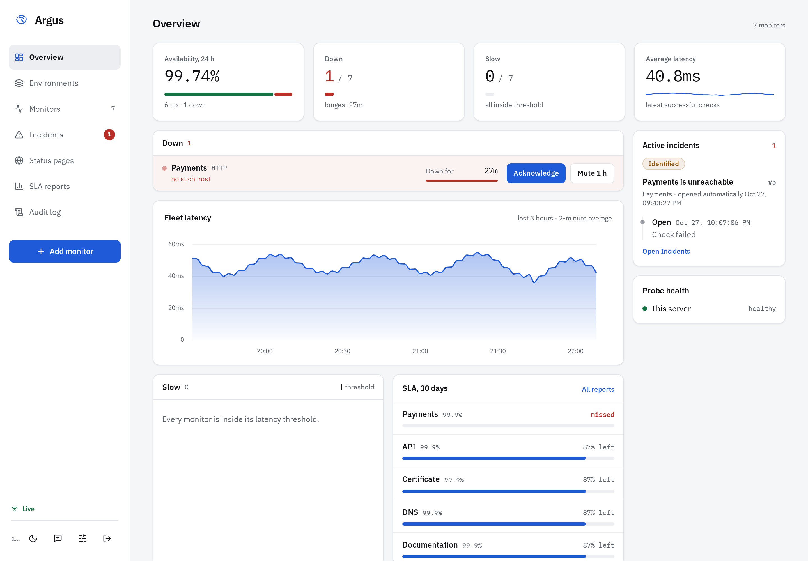
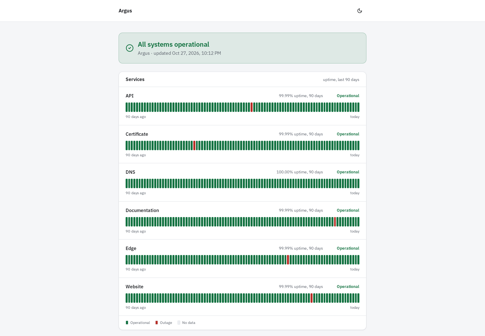

# Argus

Self-hosted uptime monitoring. It checks websites, APIs, hosts, DNS, certificates, domains, mail servers, and databases, sends alerts through the channels a team already uses, and publishes status pages. A status page shows names only. Probe targets stay private.






What changed in each version is in [CHANGELOG.md](CHANGELOG.md).

## Install

Docker and Docker Compose, on `linux/amd64` or `linux/arm64`. No Go or Node toolchain, and no clone.

```bash
mkdir argus && cd argus
curl -fsSL -o docker-compose.yml https://raw.githubusercontent.com/zypher-systems/Argus/main/docker-compose.yml
curl -fsSL -o .env.example https://raw.githubusercontent.com/zypher-systems/Argus/main/.env.example
cp .env.example .env
```

Edit `.env` before the first start:

- `POSTGRES_PASSWORD` — any characters. Postgres reads it only when the data volume is first created.
- `ARGUS_ADMIN_EMAIL` and `ARGUS_ADMIN_PASSWORD` — the first administrator. The password must be at least 8 characters, and not `change-me` or `change-me-too`. After the account exists, these are ignored.
- `ARGUS_SECRET_KEY` — optional, recommended. `openssl rand -hex 32`. It encrypts monitor credentials. Keep a copy.

```bash
docker compose up -d
```

Open http://localhost:8080 (or `ARGUS_WEB_PORT`) and sign in. Data stays in the `pgdata` volume.

Update with:

```bash
docker compose pull && docker compose up -d
```

`latest` moves when a new image is published. To stay on this version, change both image tags in `docker-compose.yml` from `latest` to `v2.16.0`.

Stop the stack with `docker compose down`. That keeps the volume. Do not pass `--volumes` unless you mean to delete the database.

Operator notes (backup, reverse proxy, upgrades): [docs/operator.md](docs/operator.md).

## Features

- ICMP ping, HTTP/HTTPS (GET/HEAD/POST, JSON path, keyword invert, proxy), TCP, TLS certificate, push/heartbeat, and groups
- Transaction monitors: up to 10 HTTP steps sharing cookies, values extracted from one response and used in the next, encrypted secrets, and alerts that name the failing step
- DNS records: A, AAAA, CNAME, MX, NS and TXT, with an expected answer
- Domain registration expiry over RDAP, warned well before it lapses
- Mail servers: SMTP, IMAP and POP3, with STARTTLS or implicit TLS
- Databases: PostgreSQL, MySQL and Redis — a fresh connection and one statement, with an optional expected result. Credentials are encrypted at rest.
- TLS certificate expiry warnings on HTTPS and cert-only checks (one-shot alert inside 14 days)
- Light and dark interface with live WebSocket updates
- Area latency charts (uPlot), uptime timeline bars, per-monitor sparklines, p50/p95/p99
- Named channels with per-event filters and per-monitor attach: email, Slack, Discord, Microsoft Teams, PagerDuty, Opsgenie, Telegram, ntfy, and generic webhooks. PagerDuty and Opsgenie alerts resolve themselves when the monitor recovers.
- SMTP as the mail transport (from Settings)
- Escalation and still-down resend; optional notification rate limit
- API tokens (Bearer / X-Api-Token) and JSON import/export including Uptime Kuma backups
- Monitor groups and dependency suppression (don't page children while the parent is down)
- Environments: named groups of monitors on their own page (cards with average latency). Monitors stays a flat list with an environment / tag / type / status filter bar. A monitor can belong to more than one.
- Maintenance windows (suppress alerts, and optionally announce the work on your status pages)
- Configurable retention (raw / hourly / daily)
- Public status pages (names only; optional branding and custom domains), with embeddable status and uptime badges and an incident RSS feed
- Incident management (auto-open from checks, manual updates)
- Status page subscribers (email confirm + webhook)
- Favicon badge showing down count, responsive layout
- Accounts and roles (admin / operator / viewer), and SSO / OIDC
- White-label branding: custom product name, logo, accent color, and login message
- Distributed probe nodes, with alerts only when enough locations agree
- SLA / SLO reporting with CSV export and a monthly uptime report by email
- Audit log
- Backup and restore (`make backup` / `make restore`, from a source checkout)
- Probe dead-man's-switch and stale-check detection
- Prometheus `/api/metrics` and an OpenAPI description at `/api/openapi.json`

The dashboard is virtualized for large fleets. **Hundreds of monitors on a small VPS is the expected range.** A 1,000-monitor SLA is not claimed; ListMonitors is timed in the test suite at 250 rows.

## The stack

```
Browser ──▶ web (nginx: React app + reverse proxy)
              ├── api   (Go: REST API, WebSocket hub, rollups)
              ├── probe (Go: ICMP scheduler, state machine, alert dispatch)
              └── db    (PostgreSQL 16)
```

- `api` and `probe` share `ghcr.io/zypher-systems/argus/backend`. The probe ICMP path uses Linux ping sockets, so it runs as the non-root container user.
- `web` is `ghcr.io/zypher-systems/argus/web`. nginx listens on **8080** inside the container.
- Services coordinate via Postgres `LISTEN/NOTIFY` (`argus_config` for reloads, `argus_events` for the live dashboard).
- Migrations run on `api` startup.
- TLS for the UI is your reverse proxy. Argus does not ship a terminator. Set `ARGUS_COOKIE_SECURE=true` when the UI is served over HTTPS.
- Containers run as non-root.
- The published images are the self-hosted build. `ARGUS_HOSTED` is ignored. An organization's plan label does not lock features.

## Alert email

1. Settings → **Email alerts (SMTP)** — host, port, encryption, credentials
2. Settings → **Notification channels** — add an Email channel (and/or webhook, Slack, Discord)
3. Send a test from that channel

## From source

`make up` builds from this checkout and starts `deploy/docker-compose.yml`. `make test` runs the backend tests in Docker. `make e2e` smokes a stack that is already up, reading the admin password and port from `deploy/.env`.

| Command | Description |
| --- | --- |
| `make up` | Build and start the source stack |
| `make down` | Stop the stack (data kept) |
| `make logs` | Follow logs |
| `make test` | Backend vet and tests, in Docker |
| `make e2e` | Compose smoke (stack must be up on `ARGUS_WEB_PORT`) |
| `make backup` | `pg_dump` into `backups/` |
| `make restore FILE=...` | Restore a dump (replaces the database) |
| `make clean` | Stop the stack and **delete the database** |

Frontend: Vite + React + TypeScript + Tailwind v4 (`frontend/`).
Backend: Go + chi + pgx (`backend/`).

## License

[MIT](LICENSE). Copyright (c) 2026 Zypher Systems.
